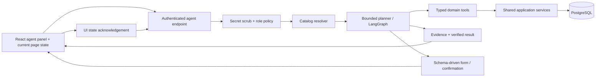

# CashPilot context-aware agent: architecture and build plan

## Goal

An embedded finance companion should answer questions, navigate to the correct view, set its filters, gather evidence, and complete permitted workflows. It should use product metadata and typed application operations, without screenshots. Its output must show what it read, changed, and verified.

Success is measured by route/state accuracy, task completion, answer faithfulness, latency, and unauthorized or invalid action rate. Compare the same tasks against a screenshot-driven baseline using the same model and machine; do not claim a speedup without measuring it.

## Current foundation and gaps

CashPilot already has React routes for overview, cash flow, invoices, payments, customers, disputes, approvals, audit, and tenants; a role/tenant-scoped Express API; PostgreSQL business tables; audit logs; notifications; and a static `/api/context/catalog` endpoint.

Before agent execution, add: stable IDs for pages/widgets/filters/actions, URL-backed UI state, a shared service layer below both HTTP routes and agent tools, typed data/evidence contracts, an agent panel, and an evaluation harness. Cash-flow numbers currently include a hard-coded projected gap; replace demo-only constants with derived figures before judging analytical correctness.

## Request flow

1. The browser sends the request plus `pageId`, route, selected entity ID, active filters/sort/date range, locale, timezone, and UI state version. User identity and tenant come only from the authenticated server session.
2. The server redacts likely secrets before persistence or model calls, resolves relevant metadata, and determines accessible tools from the actual session role.
3. Direct route/filter requests use a deterministic fast path. Ambiguous requests and multi-view analysis use one structured model call, with bounded tool loops.
4. Read tools return normalized records and source IDs. Financial arithmetic runs in deterministic code/SQL; the model explains results, not calculates ledger totals itself.
5. Missing required fields produce a form schema. Financial writes produce a proposed action and confirmation. The server executes with idempotency, rechecks authorization, then reads back the changed record.
6. The response streams progress, a `navigate/setState` command, an answer or form, citations, and an action trace. The browser applies route/state and acknowledges its final state.

## Product context and retrieval

Create one versioned catalog, ideally generated from route/action definitions rather than copied manually. Every item has a stable ID, label, description/synonyms, parent ID, route, roles, entity/data source, filter schema, action schema, and UI targets. Example IDs: `page.invoices`, `widget.invoices.grid`, `filter.invoices.status`, `action.invoice.remind`.

Retrieval order: exact IDs and aliases → hierarchy-aware PostgreSQL full-text/trigram search → optional embeddings. Inject only the matching page's widget/filter/action subset into the model prompt. At hundreds of components, benchmark top-1 and MRR first; add pgvector/HNSW only if lexical retrieval misses semantic cases. PostgreSQL exact vector search is a valid baseline before approximate indexing. Tenant and role filtering happen before retrieval results reach the model.

UI state contract: `/invoices?status=overdue&customer=c1&sort=due_date:asc&from=2026-10-01&to=2026-10-31`. Define allowed keys/values in the catalog. The app parses/validates URL state, renders it, and reports the applied state back to the agent. This prevents an answer from claiming a filter was applied when it was not.

## Tool and data contracts

Implement domain tools in TypeScript with Zod input/output schemas. The model receives only tools allowed for the current actor. Tools call shared service functions that enforce tenant/customer scope and permissions; the model never gets a raw database connection, arbitrary SQL, or a generic HTTP fetch tool.

| Family     | First tools                                                                                                                         | Notes                                                               |
| ---------- | ----------------------------------------------------------------------------------------------------------------------------------- | ------------------------------------------------------------------- |
| Navigation | `find_page`, `set_page_state`, `open_record`                                                                                        | Returns UI commands; browser acknowledges applied state.            |
| Read       | `get_dashboard`, `list_invoices`, `get_invoice`, `get_customer`, `list_payments`, `get_cashflow`, `list_disputes`, `list_approvals` | Parameterized, scoped, paginated.                                   |
| Analysis   | `compare_periods`, `explain_cash_gap`, `rank_collection_risk`, `simulate_payment_delay`                                             | Deterministic calculations with source IDs and definitions.         |
| Write      | `create_invoice`, `update_invoice`, `record_payment`, `send_reminder`, `review_dispute`, `decide_approval`, tenant/user actions     | Same business rules and audit as the UI; confirmation where needed. |

Example evidence object: `{sourceType:"invoice", sourceId:"i1", field:"balance", value:1060000, observedAt:"...", route:"/invoices?..."}`. Every numeric claim should carry supporting evidence IDs and a reproducible calculation. Answers distinguish facts from forecasts and proposed actions.

## Dynamic forms and confidential input

The tool registry supplies JSON Schema for missing fields. The UI renders the fields from the selected action schema, including labels, enums, defaults, validation, and a review step. For example, "record Acme's bank transfer" produces an invoice picker, amount, reference, date, and payment method; the model cannot invent hidden required fields.

If a user types a password, API key, or similar secret in chat: detect and redact it client-side where possible and again server-side before logs, transcript storage, or OpenRouter. Ask for the value again through a secure form if the operation requires it. Send the form value directly to a dedicated API, hash passwords with the existing password-hashing path, and return only a success marker to the agent. Do not promise perfect automatic secret detection or store a reversible "anonymized" password in the database. For personal/business identifiers needed by the model, minimize or pseudonymize them and map IDs back on the server.

## Authorization, reliability, and audit

- Session identity is authoritative. No role/tenant/customer ID supplied by the model or browser is trusted.
- Server policy decides accessible tools and record scope. Apply it again immediately before each write.
- Require a confirmation token bound to user, tenant, action, payload hash, and expiry for high-impact writes. Existing CFO approvals remain a separate business step.
- Idempotency keys prevent duplicate payments, reminders, or tenant changes on retry. Use PostgreSQL transactions for multi-record changes.
- Validate proposed tool arguments against schemas and verify results with a read-after-write. Record the actor, tool, input summary, before/after IDs, confirmation, outcome, and latency in audit/agent-run tables.
- Treat record text and retrieved metadata as data, not instructions. Restrict tool loops, output size, time, and spend per run. Show a recoverable error when a tool fails.

## Runtime and stack

The agent runs inside the TypeScript/Express service. `@langchain/langgraph` now owns the bounded model → tool → approval → finalize workflow, and `@langchain/langgraph-checkpoint-postgres` persists every node boundary. Model-backed write proposals use a resumable LangGraph interrupt; the existing pending-action row remains the authoritative, payload-hashed authorization boundary. The no-model local fallback retains its direct confirmation path so the application can still perform its narrow degraded-mode workflow when OpenRouter is unavailable. OpenRouter is called from the server through one provider adapter, and its API key remains server-only. The tool-capable model is configured with `OPENROUTER_MODEL`.

PostgreSQL stores business data, agent runs, evidence, pending actions, idempotency records, audit data, and LangGraph checkpoints. Use `pgvector` later only if measured retrieval quality warrants it. `POST /api/agent/runs` supports SSE over a streaming `fetch`: it emits `run_started`, per-node `progress`, and a final `result` event. Confirmation and rejection endpoints resume the saved graph with a `Command`; they remain separate authenticated HTTP commands so browser intent is never inferred from model text. OpenTelemetry remains a future observability enhancement.

OpenRouter privacy controls should deny provider data collection for sensitive tenants and use zero-data-retention routing where available. Prompt caching can help repeated context but must never cache live finance answers or action requests as if they were immutable.

## API and storage additions

Proposed endpoints:

- `POST /api/agent/runs` — start/stream a turn
- `GET /api/agent/runs/:id` — status, steps, evidence, UI command
- `POST /api/agent/runs/:id/input` — submit validated form data
- `POST /api/agent/runs/:id/confirm` — approve/reject proposed action
- `POST /api/agent/ui-state/ack` — report applied page/filter state
- `GET /api/agent/catalog` — accessible metadata for debug/evals

Add migrations for `app_components`, `agent_runs`, `agent_steps`, `agent_messages` (redacted), `agent_pending_actions`, `agent_evidence`, and `idempotency_keys`. Do not rely on editing `db/init.sql` alone: existing Docker volumes require a migration runner so the agent can be added without deleting user data.

## Implementation sequence

1. **Foundation:** migration runner, shared service layer, catalog IDs/schemas, URL-backed state on invoices/cash flow/customers, auth/tenant policy tests.
2. **Read and navigate:** agent panel, current-page context, deterministic route resolver, typed read tools, OpenRouter adapter, streaming answer with source links.
3. **Actions:** schema-driven forms, confirmation/resume, write tools, idempotency, read-after-write, audit trace. Cover invoice update, reminder, payment, dispute review, and tenant action.
4. **Analysis and proactivity:** deterministic period comparisons/cash-gap analysis; scheduled risk detector writes notifications and proposed actions. Agent can explain each signal and continue the workflow.
5. **Evaluation and polish:** labelled request corpus, synthetic 300–500-component metadata catalog, screenshot-baseline comparison, latency/token/accuracy dashboard, four-role demo rehearsal.

## Evaluation gates

Use a held-out set with navigation, UI-state, analysis, action, missing-field, cross-role, cross-tenant, secret-input, and failure-recovery cases. Report exact-match route and state, task success, source-backed numeric claims, retrieval top-1/MRR, p50/p95 latency, token use, and invalid/unauthorized action attempts. Suggested hackathon targets: ≥95% route and state exact match, ≥90% multi-step completion, 100% source-backed numeric claims in tested answers, zero unauthorized writes in adversarial tests. Latency and token-saving targets should be set from measured screenshot-agent baselines, not guessed.

## Demo sequence

1. CFO sees a proactive cash-gap signal.
2. "Why is this happening?" opens cash flow with the right period and cites specific invoices/payments.
3. "Recover cash without escalating our strategic customer" ranks options and proposes a payment-plan/reminder workflow.
4. Missing details appear as a form; CFO confirms; agent executes and verifies the changed records.
5. Switch to Customer: own dispute status and resolution are visible; an attempt to inspect another tenant or approve CFO actions is denied.
6. Show the execution trace beside a screenshot-based baseline: calls, tokens, latency, evidence, and audit IDs.

## Decisions and tradeoffs

| Choice                            | Reason                                     | Cost / trigger to revisit                                             |
| --------------------------------- | ------------------------------------------ | --------------------------------------------------------------------- |
| Shared service layer, typed tools | Reuses domain validation and permissions   | Refactor current monolithic route handlers first.                     |
| LangGraph for stateful runs       | Durable approval and recovery              | Keep simple route commands on a direct fast path.                     |
| PostgreSQL metadata search first  | Small operational footprint                | Add pgvector when measured semantic misses justify it.                |
| Server-side calculations          | Reproducible finance answers               | Model can explain, but cannot be the ledger calculator.               |
| Secure forms for secrets          | Keeps raw credentials out of model context | Typed chat secrets must be discarded/redacted and re-entered.         |
| One API process initially         | Simple local deployment and low hop count  | Split workers when sustained queue load or isolation needs demand it. |
